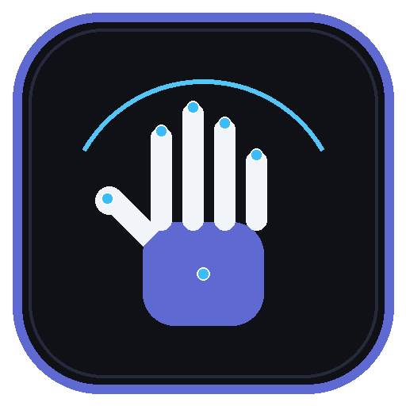
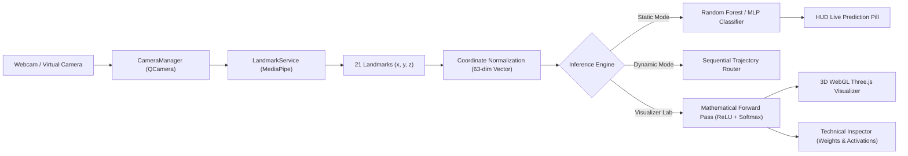

# SignFlow Studio — Computer Vision ASL Recognition & Neural Network Laboratory

<p align="center">
  
</p>

<p align="center">
  <strong>A commercial-grade, native Windows desktop application for real-time American Sign Language (ASL) recognition, complete machine-learning dataset lifecycle management, and interactive 3D deep neural network architecture inspection.</strong>
</p>

<p align="center">
  
  
  
  
  
  
  
</p>

---

## ✦ Table of Contents

- [Overview](#-overview)
- [Key Features](#-key-features)
  - [1. Dynamic Camera Device Architecture](#1-dynamic-camera-device-architecture)
  - [2. Multi-Model Live ASL Recognition](#2-multi-model-live-asl-recognition)
  - [3. Static Classifier Training Workspace](#3-static-classifier-training-workspace)
  - [4. Dynamic Gesture Trajectory Workspace](#4-dynamic-gesture-trajectory-workspace)
  - [5. Dataset Curation, Preview & Rollback](#5-dataset-curation-preview--rollback)
  - [6. Safe Binary Model Artifact Catalog](#6-safe-binary-model-artifact-catalog)
  - [7. Neural Network Laboratory (3D WebGL + Technical Inspector)](#7-neural-network-laboratory-3d-webgl--technical-inspector)
  - [8. Strict Zero-Background-Rendering Engine](#8-strict-zero-background-rendering-engine)
- [Technical Architecture & Directory Layout](#-technical-architecture--directory-layout)
- [How It Works (Pipeline Deep Dive)](#-how-it-works-pipeline-deep-dive)
- [Installation & Setup](#-installation--setup)
- [Running the Application](#-running-the-application)
- [Building the Standalone Windows Executable](#-building-the-standalone-windows-executable)
- [Automated Verification Test Suites](#-automated-verification-test-suites)
- [Security, Privacy & Architectural Boundaries](#-security-privacy--architectural-boundaries)
- [Meet the Creators](#-meet-the-creators)

---

## ✦ Overview

**SignFlow Studio** is a modern, high-performance desktop workstation bridging computer-vision machine learning with a production-grade developer tool experience inspired by Linear and Raycast. 

Unlike conventional browser-based demos or Electron wrappers, SignFlow Studio is built natively on **PySide6 (Qt for Python)**, providing hardware-accelerated video rendering, robust camera device lifecycle management, and a dedicated **Neural Network Visualizer & Technical Inspector** powered by an embedded hardware-accelerated **Three.js WebGL** scene.

The application strictly preserves modular segregation between UI presentation, hardware capture, and machine-learning execution, ensuring that live webcam streaming, MediaPipe hand landmark extraction, and scikit-learn model inference remain 100% deterministic, responsive, and secure.

---

## ✦ Key Features

### 1. Dynamic Camera Device Architecture
* **Hardware & Virtual Capture Support**: Seamlessly discovers and interfaces with physical webcams, capture cards, and virtual video sources (e.g., **Iriun Webcam**, **DroidCam**, **OBS Virtual Camera**).
* **Non-Blocking Centralized Lifecycle**: Managed by `CameraManager`, which owns device initialization, frame acquisition, and format conversion.
* **Instant Device Switching**: Hot-swap capture devices on the fly without memory leaks or OS hardware lock contention.
* **QSettings Device Memory**: Remembers user device preferences, mirror configuration, and resolution profiles across sessions.

### 2. Multi-Model Live ASL Recognition
* **Real-Time Hand Landmark Extraction**: Integrated with Google MediaPipe's Hand Landmarker Task, isolating 21 3D hand landmarks (63-dimensional coordinate vectors) per frame.
* **Three Recognition Modes**:
  * **Static Mode**: Evaluates stationary hand shapes (Signs A through F) with sub-20ms inference latency.
  * **Dynamic Mode**: Analyzes temporal trajectory paths for movement-based signs (`Z` and `J`).
  * **Combined Router**: Dynamically routes landmark features through static or sequential classifiers based on landmark velocity and variance.
* **Confidence Filtering & Telemetry**: Displays real-time predicted signs, confidence percentages, latency benchmarks, and buffered text output with backspace and clear controls.

### 3. Static Classifier Training Workspace
* **Direct ML Integration**: Mirrors backend hyperparameters from `train_model.py` (`n_estimators`, `test_size`, `random_state`).
* **Interactive Sample Collector**: Built-in sample collection interface allowing users to record new landmark samples for any sign with countdown timers and automated feature extraction.
* **Collection Diversity Guide**: Comprehensive reference cards covering lighting variations, distance scaling, camera angles, and background contrast.

### 4. Dynamic Gesture Trajectory Workspace
* **Temporal Motion Tracking**: Dedicated canvas visualizing the real-time movement trajectory of fingertips for signs requiring motion (`Z` and `J`).
* **Sequence Hyperparameters**: Configurable sequence length, stride, and motion threshold sliders.
* **Architectural Segregation**: Strict guardrails preventing static training scripts from corrupting dynamic sequence pipelines.

### 5. Dataset Curation, Preview & Rollback
* **Flexible Import Modes**: Supports both **Managed Copy** (copies file into local storage) and **Linked Reference** (binds to an external path without moving).
* **10-Row Interactive Table Preview**: Instantly inspect feature headers, row counts, and sample coordinate distributions.
* **Reversible Rollback History**: Safely replace active datasets with automatic backup generation, enabling 1-click rollback to previous CSV states.

### 6. Safe Binary Model Artifact Catalog
* **Non-Executive Cataloging**: Safely registers model files (`.joblib`, `.task`, `.onnx`, `.tflite`, `.pt`, `.h5`) without arbitrary unpickling or security vulnerabilities.
* **Model Integrity Inspection**: Computes file sizes, SHA-256 hashes, modification timestamps, and compatibility matrices directly on disk.

### 7. Neural Network Laboratory (3D WebGL + Technical Inspector)
* **Authoritative ML Backend**: Directly inspects and visualizes real trained Multi-Layer Perceptron (MLP) neural networks:
  * **Dense Architecture (`asl_neural_net_dense.joblib`)**: 63 Inputs ➔ 64 Dense (ReLU) ➔ 32 Dense (ReLU) ➔ 6 Outputs (Softmax) [6,374 parameters].
  * **Compact Architecture (`asl_neural_net_compact.joblib`)**: 63 Inputs ➔ 32 Dense (ReLU) ➔ 16 Dense (ReLU) ➔ 6 Outputs (Softmax) [2,678 parameters].
* **Cinematic 3D WebGL Visualization**:
  * Rendered via embedded Three.js inside an isolated `QWebEngineView`.
  * Spatial node placement, layer columns, dynamic color-coded weight connections, and 3D raycasting.
  * Hover any neuron in 3D to inspect its layer index, unit number, bias, and live activation.
  * OrbitControls with smooth damping, zoom bounds, auto-fit, and camera resets.
* **Authentic Mathematical Forward Pass**:
  * Evaluates genuine feature vectors from dataset samples or live camera landmarks.
  * Animates signal propagation across layers in real time.
  * Winning output class highlights in glowing emerald green with true Softmax probabilities.
* **Engineering-Grade Technical Inspector**:
  * **Architecture Overview**: Total parameter tally, trainable weights count, layer dimensions, and activation functions.
  * **Weight Matrix Heatmap**: Interactive 2D color grid visualizing raw weight tensors.
  * **20-Bin Weight Distribution Histogram**: Statistical distribution of weights with min, max, mean, and standard deviation.
  * **Detailed Activations Table**: Raw pre-activation values ($z$), post-activation values ($a$), and neuron biases.
* **Native 2D Canvas Fallback**:
  * Custom antialiased `QPainter` schematic rendering providing a lightweight, zero-WebGL fallback.

### 8. Strict Zero-Background-Rendering Engine
* **Render-Only-When-Open**: The 3D WebGL scene and WebEngine context are **lazily initialized** only when the user opens the Neural Network Lab.
* **Immediate Deactivation**: Navigating away from the page instantly halts all `requestAnimationFrame` loops, pauses WebGL rendering, and stops Qt event polling timers.
* **Idle-Paused Rendering**: Even while the visualizer is open, continuous 60 FPS animation loops are paused when the scene is static; frames are rendered strictly on-demand (camera drag, hover change, or active forward pass).
* **Document Visibility Integration**: Automatically suspends animation if the application window is minimized or hidden.
* **Performance Guarantee**: Predict Live, camera preview, and MediaPipe landmark extraction run at 100% capacity with zero CPU/GPU contention.

---

## ✦ Technical Architecture & Directory Layout

```
signlanguage/
├── run_app.py                      # Production application launcher
├── run.bat                         # Windows double-click launcher
├── build_exe.py                    # Automated PyInstaller build script
├── SignLanguageStudio.spec         # PyInstaller compilation specification
├── create_desktop_shortcut.ps1     # PowerShell desktop shortcut generator
├── requirements.txt                # Core runtime dependencies
├── static_signs.csv                # Authoritative static ASL landmark dataset
├── README.md                       # Comprehensive project documentation
├── .gitignore                      # Git exclusion rules (venv, secrets, cache)
│
├── app/                            # Primary Application Package
│   ├── main.py                     # Entry point & QApplication lifecycle
│   │
│   ├── core/                       # Core Business Logic & ML Adapters
│   │   ├── config.py               # Constants, Paths, QSettings persistence
│   │   ├── theme.py                # Linear Dark / Clean Light theme engine & QSS
│   │   ├── camera_manager.py       # QMediaDevices, QCamera, QVideoSink frame pipeline
│   │   ├── landmark_service.py     # Thread-safe MediaPipe hand landmark extraction
│   │   ├── interfaces.py           # Typed integration contracts for ML backends
│   │   ├── backend_adapter.py      # Bound prediction, training & collection adapters
│   │   ├── backend_manager.py      # Module mapping & non-executive directory scanner
│   │   ├── dataset_registry.py     # CSV dataset import, preview, replace & rollback
│   │   ├── model_registry.py       # Safe zero-deserialization model artifact catalog
│   │   └── neural_network_service.py # Neural net inspection & forward pass engine
│   │
│   ├── ui/                         # User Interface Layer (PySide6)
│   │   ├── main_window.py          # Application shell, navigation router, page stack
│   │   │
│   │   ├── components/             # Reusable Modular UI Components
│   │   │   ├── sidebar.py          # Modern sidebar with active navigation pills
│   │   │   ├── top_bar.py          # Global header with model selector & theme toggle
│   │   │   ├── widgets.py          # Status pills, stat cards, section headers
│   │   │   ├── searchable_combo.py # Filterable device & model dropdown
│   │   │   ├── error_dialog.py     # Expandable diagnostic error modal
│   │   │   ├── backend_import_dialog.py # Backend folder inspector & mapper dialog
│   │   │   ├── neural_network_3d_widget.py # Hardware-accelerated 3D WebGL widget
│   │   │   ├── neural_network_2d_widget.py # Native antialiased QPainter 2D schematic
│   │   │   └── neural_network_inspector.py # Technical Inspector, heatmaps & histograms
│   │   │
│   │   └── pages/                  # Primary Workspaces
│   │       ├── overview_page.py    # System dashboard, metrics & quick actions
│   │       ├── predict_page.py     # Live camera ASL prediction workspace
│   │       ├── static_training_page.py  # Static model training workspace
│   │       ├── dynamic_training_page.py # Dynamic sequence trajectory workspace
│   │       ├── dataset_manager_page.py  # CSV dataset manager, preview & rollback
│   │       ├── model_manager_page.py    # Model artifact catalog & inspector
│   │       ├── settings_page.py    # Preferences, camera defaults & backend setup
│   │       └── neural_network_page.py   # Dedicated Neural Network Laboratory
│   │
│   └── resources/                  # Application Assets & Offline Libraries
│       ├── app_icon.ico            # High-resolution Windows application icon
│       ├── app_icon.png            # 512x512 PNG master icon
│       ├── icons.py                # High-DPI theme-aware SVG vector icons
│       ├── js/                     # Offline JavaScript Dependencies
│       │   ├── three.min.js        # Three.js 3D WebGL library
│       │   └── OrbitControls.js    # Camera orbit and pan controls
│       └── templates/
│           └── neural_network_3d.html # Self-contained Three.js 3D laboratory scene
│
├── models/                         # Authoritative Machine Learning Artifacts
│   ├── asl_classifier.joblib       # Primary Random Forest static classifier (A–F)
│   ├── asl_neural_net_dense.joblib # Deep MLP Neural Network (63-64-32-6)
│   ├── asl_neural_net_compact.joblib # Compact MLP Neural Network (63-32-16-6)
│   └── hand_landmarker.task        # MediaPipe Hand Landmarker Task binary
│
├── [ML Backend Scripts - Segregated & Intact]
│   ├── collect_static_data.py      # Standalone static landmark collection script
│   ├── collect_static_data_website.py # Web-based static collection helper
│   ├── hand_detection.py           # Standalone MediaPipe OpenCV test script
│   ├── predict_live.py             # Standalone live prediction script
│   └── train_model.py              # Standalone Random Forest training script
│
└── [Verification & Test Suites]
    ├── test_app_smoke.py           # 15-point UI lifecycle & component smoke test
    ├── test_training_workspaces.py # Camera sharing & training workspace test
    ├── test_backend_integration.py # ML adapter contract & boundary test
    ├── test_neural_network_visualizer.py # 15 acceptance criteria for NN visualizer
    └── test_nn_zero_background_rendering.py # Zero background rendering & isolation test
```

---

## ✦ How It Works (Pipeline Deep Dive)



1. **Camera Frame Tap**: `CameraManager` captures raw camera frames via `QVideoSink` and emits them to `LandmarkService`.
2. **Landmark Normalization**: MediaPipe isolates 21 landmark points in normalized camera space ($[0.0, 1.0]$). The service translates all points relative to the wrist (Landmark 0) and normalizes for hand-to-camera distance, producing an orientation-invariant 63-dimensional feature vector.
3. **Model Evaluation**:
   * For live prediction, features are dispatched to the selected model (`asl_classifier.joblib` or neural net).
   * For the Neural Network Lab, features are routed to `NeuralNetworkService.execute_forward_pass()`, which computes exact layer-by-layer linear combinations ($z = W \cdot x + b$) and activations ($a = \text{ReLU}(z)$, $p = \text{Softmax}(z_{\text{out}})$).
4. **Synchronized Visualization**: Activations are dispatched simultaneously to the Three.js 3D scene (animating electrical node pulses) and the Technical Inspector (populating heatmaps, histograms, and data tables).

---

## ✦ Installation & Setup

### Prerequisites
* **Operating System**: Windows 10 or Windows 11 (64-bit)
* **Python Runtime**: Python 3.10 or Python 3.11 (Python 3.11.9 recommended)
* **Hardware**: Standard USB webcam or virtual camera software (Iriun, DroidCam, OBS)

### 1. Clone the Repository
```bash
git clone https://github.com/ayushpandey67/signlanguage.ai.git
cd signlanguage.ai
```

### 2. Set Up Python Virtual Environment
```powershell
python -m venv .venv
.\.venv\Scripts\Activate.ps1
```

### 3. Install Dependencies
```powershell
pip install -r requirements.txt
```

---

## ✦ Running the Application

### Option A: Double-Click Launcher (Fastest)
Simply double-click `run.bat` in the project root. It will automatically detect your local `.venv` environment and launch SignFlow Studio.

### Option B: Terminal Command
```powershell
.\.venv\Scripts\python run_app.py
```

---

## ✦ Building the Standalone Windows Executable

You can compile SignFlow Studio into a self-contained, native Windows `.exe` that runs without requiring Python installed:

```powershell
.\.venv\Scripts\python build_exe.py
```

* **Output Executable**: `dist\SignFlowStudio\SignFlowStudio.exe`
* **Create Desktop Shortcut**:
  ```powershell
  powershell -ExecutionPolicy Bypass -File create_desktop_shortcut.ps1
  ```

---

## ✦ Automated Verification Test Suites

SignFlow Studio includes 5 comprehensive test suites ensuring 100% stability, thread safety, and zero regression:

| Test Suite | Command | What It Verifies |
| :--- | :--- | :--- |
| **App Smoke Test** | `python test_app_smoke.py` | Validates QApplication lifecycle, theme switching, camera discovery, and 7 core pages. |
| **Training Workspaces** | `python test_training_workspaces.py` | Validates non-blocking camera sharing between Static and Dynamic training workspaces. |
| **Backend Integration** | `python test_backend_integration.py` | Verifies ML adapter contracts, boundary isolation, and prediction execution. |
| **Neural Net Visualizer** | `python test_neural_network_visualizer.py` | Verifies 15 criteria: real weights, parameter calculations, forward pass, and layer sync. |
| **Zero Background Rendering** | `python test_nn_zero_background_rendering.py` | Verifies lazy WebEngine loading, 0 background CPU/GPU usage, and idle loop pausing. |

Run any test suite directly from your terminal:
```powershell
.\.venv\Scripts\python test_nn_zero_background_rendering.py
```

---

## ✦ Security, Privacy & Architectural Boundaries

1. **100% Local Execution**: All camera frames, landmark detections, and model evaluations occur strictly in local memory. **No video frames or biometric landmark data are ever transmitted to external servers.**
2. **Safe Model Cataloging**: Model artifact inspection uses non-executive header parsing. Arbitrary code execution via unsafe `.pkl` / `.joblib` unpickling is strictly blocked.
3. **Decoupled Backend Boundary**: UI components communicate with ML models solely through strongly typed abstract interfaces in `app/core/interfaces.py`. The original training scripts and CSV datasets remain completely untouched.
4. **Environment Isolation**: `.gitignore` strictly excludes local virtual environments, OS configurations, and build artifacts to maintain repository cleanliness.

---

## ✦ Meet the Creators

**SignFlow Studio** was conceived, engineered, and developed by:

* **Ayush Pandey** — System Architecture, UI/UX Engineering, 3D WebGL Visualization & ML Core Integration
* **Rajat** — Computer Vision Pipeline, Dataset Curation & ASL Gesture Modeling

*Class XI, Yuvashakti Model School*  
*Specialization: Computer Science & Artificial Intelligence*

---

<p align="center">
  <sub>© 2026 SignFlow Studio. Engineered with precision for real-time computer vision accessibility.</sub>
</p>
